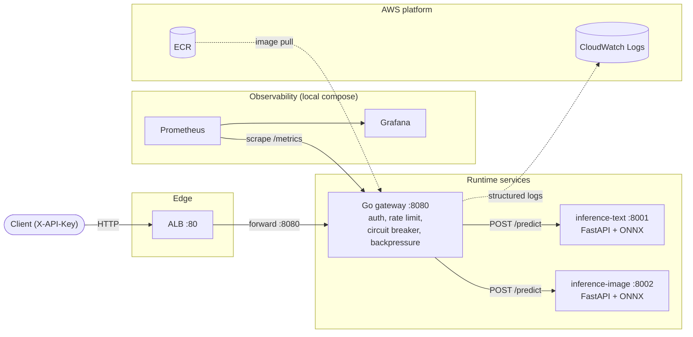

# vigil

[](https://github.com/mriviere-company/vigil/actions/workflows/ci.yml)

A portfolio project demonstrating AI infrastructure engineering: a
content-moderation API where you send text or an image and get back
`approved` / `flagged` / `rejected` with a confidence score and per-category
breakdown, in under 200 ms at p95. The ML is deliberately off-the-shelf; the
engineering — a resilient Go gateway in front of two Python inference
services, wired for observability, cost control, and infrastructure-as-code —
is the point. It is not offered as a product or service; it exists to show
production serving done properly, end to end.

## The scenario

The design brief the project is built against: SMBs that host user-generated
content (reviews, marketplace listings, forum posts, image uploads) have a
legal and reputational obligation to moderate it, but neither the budget for
a dedicated trust-and-safety team nor the in-house skills to integrate ML
models. The commercial options are either expensive per-request SaaS or
complex platforms that assume an ML team you don't have. vigil plays the
thin, self-hostable middle: one REST endpoint, tiered API keys, a verdict in
milliseconds.

## Solution

A gateway exposes `POST /v1/moderate/{text,image}`; it authenticates the
caller, enforces per-tenant rate limits, calls the appropriate inference
service, and aggregates the raw model scores into a single verdict. Toxic
content is rejected with the category scores that drove the decision — here
against the real ONNX multilingual toxicity model that ships today
(`multilingual-toxic-xlm-r-onnx-int8-1`, re-captured 2026-07-12; see
[`benchmarks/README.md`](benchmarks/README.md) for why it replaced the
earlier `toxic-bert` backend), captured live from a locally-running stack:

```console
$ curl -sS -X POST http://localhost:8080/v1/moderate/text \
    -H "X-API-Key: dev-free" -H "Content-Type: application/json" \
    -d '{"content": "I will find you and hurt you, you worthless piece of garbage"}'
{
    "id": "93d2d9cd-c10d-418f-aae8-3e54e13b7d6a",
    "verdict": "rejected",
    "score": 0.9956703186035156,
    "categories": {
        "spam": 0,
        "toxicity": 0.9956703186035156
    },
    "latency_ms": 12
}
```

Benign text on the same endpoint returns `approved` with `score` ≈ 0.004. The
verdict rule is configurable (`rejected` if any score > 0.85, `flagged` if
> 0.5, else `approved`); the full contract is in [`docs/api.md`](docs/api.md).

## Features

- **FR/EN toxicity benchmark**: swapping the text model to a multilingual
  backend measures a +0.20 ROC-AUC gain on French toxicity detection while
  holding English quality (parity within the pre-declared threshold) —
  honestly caveated as directionally correct rather than an exact-magnitude
  claim; full methodology and known biases in
  [`benchmarks/README.md`](benchmarks/README.md).
- **DSA Article 17-shaped statement of reasons + tamper-evident audit log**:
  every completed moderation decision can emit a machine-readable
  statement-of-reasons draft and is recorded in an append-only, hash-chained
  audit log — evidence to help a platform meet its own Article 17 obligation,
  not a compliance guarantee; see
  [`docs/api.md`](docs/api.md#statement-of-reasons-dsa-article-17).

## Architecture



Prometheus and Grafana run in the local `docker compose` stack; ECR and
CloudWatch back the same services on AWS. `/metrics` is internal-only — blocked
at the ALB by a listener rule so it never leaves the VPC.

**Why Go for the gateway.** The gateway is a concurrency and latency problem,
not a business-logic one: fan-out to inference services, per-key rate limiting,
in-flight backpressure, and a circuit breaker all want cheap goroutines and
tight control over timeouts and cancellation. Go gives that with the standard
library alone (no web framework), compiles to a single ~11 MB static binary,
and ships on a `distroless/static` base image — a small attack surface and a
fast cold start, which matters on Fargate.

**Why a hand-written circuit breaker.** `sony/gobreaker` would have worked; the
head comment in `gateway/internal/circuit` says so. Owning ~150 lines instead
is a deliberate portfolio choice — this is the resilience primitive the project
is about. It uses a consecutive-failures policy with an injected `Clock`, and
evaluates the Open→HalfOpen transition lazily on request arrival rather than
from a background timer, so there is no goroutine to leak and every state
transition is unit-tested deterministically with zero `time.Sleep` (including a
50-goroutine race-detector hammer test).

**Why Fargate.** The workload is three stateless services that scale
independently and are torn down between demos — there is no reason to manage
EC2 nodes or an EKS control plane. Fargate bills per task-second, runs the dev
environment on `FARGATE_SPOT` (this workload already tolerates a task
vanishing), and target-tracking autoscaling (min 1 / max 3 per service) plus
the ECS deployment circuit breaker handle scale-out and failed-task rollback
without extra machinery.

## Performance 📈

Measured with k6 against a natively-run stack (gateway + both inference
services), ramping 0→15 req/s over 1 min and holding — see
[`loadtest/k6/`](loadtest/k6/). Re-measured 2026-07-12 with the shipped
multilingual ONNX model (`multilingual-toxic-xlm-r-onnx-int8-1`) in the
request path — these numbers replace the earlier `toxic-bert`-era run:

```
=== vigil k6 ramp summary (ONNX backend, multilingual XLM-R int8) ===
http_reqs: 2474
http_req_duration: avg=12.28ms p50=11.38ms p90=13.85ms p95=18.25ms p99=29.35ms max=78.83ms
error rate (excl. 202): 0.00%
checks passed: 100.00%

thresholds:
  http_req_duration p(95)<200: PASS
  errors rate<0.01: PASS
```

**p95 = 18.3 ms — about 9% of the 200 ms budget.** Re-running the identical
ramp with the deterministic stub backend gives p95 = 4.6 ms, so the ~13.7 ms
delta is the actual cost of one CPU ONNX forward pass (tokenize + inference)
in the request path today — smaller than the ~32 ms the retired `toxic-bert`
model cost in the same test. That is not a contradiction of
[`benchmarks/README.md`](benchmarks/README.md)'s own finding that the new
model is ~10 ms slower *per single inference* than the old one: that
benchmark deliberately pins onnxruntime to one thread to approximate a small
Fargate vCPU allocation, while this service's `InferenceSession`
(`inference/text/app/model.py`) leaves onnxruntime at its default
multi-threaded settings — which, on this 16-thread desktop host, benefits the
larger XLM-R model more than the smaller one it replaced. The two figures
measure different things and aren't directly comparable. The takeaway still
holds: the model, not the gateway, is the dominant cost, and the pipeline
sits comfortably inside the latency target.

The burst test (`loadtest/k6/burst.js`, `dev-free` key, no think-time) confirms
the rate limiter: every throttled request gets `429` with a `Retry-After`
header and the normalized error envelope, permitted requests still succeed, and
there are **zero 5xx** across the run — all thresholds green.

<!-- TODO: Grafana screenshots once docker available (make up && make load-test) -->

## Cost 💵

The dev environment is deployed on demand and destroyed after each session
(see [Run it](#run-it)); costs below are the *if left running* baseline.
Line items priced at us-east-1 rates — ca-central-1, this repo's deploy region,
runs ~5–10% higher. Full breakdown in [`infra/README.md`](infra/README.md).

| Scenario | NAT GW | ALB | Fargate (3 tasks, min) | Logs + ECR | **Total/mo** | **Total/hr** |
|---|---|---|---|---|---|---|
| On-demand FARGATE, 24/7 (baseline) | ~$33 | ~$18 | ~$45 | ~$3 | **~$100** | **~$0.13** |
| **FARGATE_SPOT + NAT** (dev default) | ~$33 | ~$18 | ~$13 | ~$3 | **~$67** | **~$0.09** |
| FARGATE_SPOT, public subnets, no NAT (future option, not built) | $0 | ~$18 | ~$13 | ~$3 | **~$34** | **~$0.05** |

Fargate compute is the gateway (0.25 vCPU / 512 MB) plus two inference services
(0.5 vCPU / 1 GB each) at min capacity; scaling out raises only that line, not
the fixed NAT/ALB costs. Further levers exist but are not implemented here:
replacing the ALB with an API Gateway HTTP API, or scale-to-zero when idle —
both would push the running cost lower still.

**Unit economics.** At the ~12 req/s sustained rate of the ramp test, the dev
stack (~$0.09/hr on Spot) works out to roughly $0.002 per 1,000 inferences —
two to three orders of magnitude below typical per-request commercial moderation
APIs, which price on the order of $1–2 per 1,000. The self-hosted case is a cost
argument as much as a control one, and *"the infra rebuilds in minutes"* is
itself the demonstration that the IaC works.

## Failure modes 🛡️

Each row is a real, tested behavior, not a design aspiration.

| Failure | Observed behavior | Mechanism |
|---|---|---|
| Inference service down | repeated `502`, then at the failure threshold the breaker opens → `202 {"status":"pending","retry_after":30}`; recovers open → half-open → closed when the service returns | Per-downstream circuit breaker (`internal/circuit`) |
| Downstream timeout / network error | `502 upstream_error` after ≤ 2 retries | Proxy with exponential backoff + full jitter; retries 5xx/network only, never 4xx (`internal/proxy`) |
| Burst over tier limit | `429 rate_limited` + accurate `Retry-After` | Per-key token bucket, free 2 rps/burst 5, pro 20 rps/burst 50 (`internal/ratelimit`) |
| Overload (in-flight saturated) | `503 overloaded` (or `202 pending` in degraded mode) | Bounded in-flight semaphore per downstream (`internal/server` backpressure) |
| Gateway task killed | Zero-downtime drain; capacity replaced | Graceful shutdown (signal → context → `Server.Shutdown`) + ECS min 1 / max 3 autoscaling |

The breaker recovery is not theoretical — the smoke test killed the text
service, watched the breaker open after the threshold and shed load as `202`,
restarted the service, and observed the next probe close the circuit. The
`gateway_circuit_transitions_total` metric recorded the full
`closed → open → half_open → closed` sequence.

## Run it 🚀

**Quickstart (prebuilt images, no build, no model download).** Pulls the
gateway plus both inference services (stub backend) straight from GHCR —
these images are published by CI on every green push to `main` (see the
`publish` job in [`ci.yml`](.github/workflows/ci.yml)):

```bash
git clone https://github.com/mriviere-company/vigil.git && cd vigil
docker compose -f docker-compose.quickstart.yml up -d
```

Measured (2026-07-13, from the public GHCR images on a fast connection):
**~16 s** cold — `up` pulls the ~840 MB of images and reaches the first
verdict; **6.5 s** warm, once the images are already on disk. The pull is the
variable part, so your cold number tracks your bandwidth.

Then exercise it with the dev keys (`dev-free`, `dev-pro`):

```bash
curl -sS -X POST http://localhost:8080/v1/moderate/text \
  -H "X-API-Key: dev-free" -H "Content-Type: application/json" \
  -d '{"content": "hello world"}'
```

**From source (needs Docker).** Builds all 3 images locally and also brings
up Prometheus and Grafana:

```bash
git clone https://github.com/mriviere-company/vigil.git && cd vigil
make up          # docker compose up -d --build
```

`make load-test` runs the k6 ramp against the running stack; `make down` tears
it all down. Grafana is at `http://localhost:3000`, Prometheus at `:9090`.

**AWS (ECS Fargate).** Deploy on demand, destroy after — three steps, detailed
(with the required image-build/push commands) in [`infra/README.md`](infra/README.md):

```bash
./infra/scripts/bootstrap-backend.sh              # once ever: S3 state + DynamoDB lock
export TF_VAR_api_keys="<free-key>:free,<pro-key>:pro"   # your own keys, never committed
cd infra/environments/dev && terraform apply      # or: gh workflow run deploy.yml -f action=apply
terraform destroy                                 # always, at end of session
```

The [`deploy.yml`](.github/workflows/deploy.yml) workflow runs the same
apply/destroy via `workflow_dispatch` with OIDC — no long-lived AWS keys.

> **Note:** `make up` requires a running Docker daemon. The gateway alone builds
> and runs without it (`make build && ./bin/gateway`); the inference services
> run under `uv`.

## Limitations & next steps

Honest scope boundaries, most documented inline in the code:

- **API keys live in config/env, not a database.** DynamoDB is the intended
  next step. Consequently monthly quotas are in-memory counters that reset on
  restart — only the per-second rate + burst are actually enforced across
  restarts.
- **HTTP-only ALB**, no domain or ACM certificate. Don't send real secrets
  through it; TLS/ACM is the obvious follow-up.
- **Models are off-the-shelf**, not fine-tuned — the ML is intentionally not the
  focus. The text model emits toxicity only, so `spam` (text) and `violence`
  (image) scores currently return `0.0`; a second model per signal is the
  documented extension point in `inference/*/app/model.py`.
- **ECS runs the stub backend by default** in the dev tfvars; baking the ONNX
  models into the images (or loading them from S3 via a scoped task role) is the
  next infrastructure step.
- **Grafana screenshots are pending** a Docker host; the dashboard is
  provisioned and committed under `monitoring/`.
- **The AWS environment is deployed on demand, not left running.** The first
  real `terraform apply` ran 2026-07-11 (ca-central-1, 61 resources, 4 min 20 s)
  and the API was validated live through the ALB before `terraform destroy`
  (3 min 02 s) per the cost rule below — see
  [`infra/README.md`](infra/README.md#deploy--destroy-procedure) for the full
  timing. There is no standing demo stack to point at; redeploying for a live
  check is the expected workflow (see [Run it](#run-it)).

## Contact

Live demo (the full AWS stack) available on request —
[LinkedIn](https://www.linkedin.com/in/rivierematthieu/).
